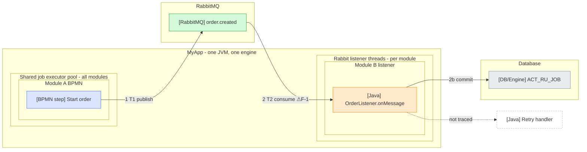
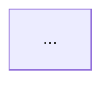

# Flow Diagram

Build an end-to-end, time-ordered diagram of every interaction and component a
transaction touches, starting from an entry point, and use the trace to find race
conditions and performance issues.

## 1. Collaboration

- Work in baby steps: trace **one step at a time**, then stop and check in.
- Make **no assumptions**. Consult the user even for tiny assumptions or checks.
- Always answer the user's question before asking a new one. One question at a time.
- Don't make structural choices the user didn't ask for (e.g. splitting diagrams). Ask.

## 2. Evidence

- Every claim cites evidence: `path/File.java:L10-L42`.
- State assumptions and confidence level (high/medium/low) for each step.
- Verify framework/engine semantics in the **actual library sources** (jar sources,
  `~/.m2`, `~/.gradle`, vendored code), not from memory. Examples: async
  before/after boundaries, transaction propagation, job executor acquisition,
  listener ack modes. Record each as verified semantics **E-n** with source citation.

## 3. Thread and context tracking

On every thread hop record:

- Which thread/pool runs the step (label threads T1, T2, …).
- Thread-local / context state (e.g. `ProcessContext`, `InheritableThreadLocal`,
  MDC, security context): where it is **set**, where it is **cleared**, and where it
  may be **stale** (pooled threads, inherited values).
- Transaction boundaries: where a transaction starts, commits, or rolls back.

## 4. Records

Keep these numbered lists in the doc (numbers are stable, never reused):

- **E-n** verified semantics (with library source citation).
- **F-n** findings. Prefix ⚠ for race conditions and performance issues.
- **OT-n** open tasks.
- **Next steps** and **Open questions**.

## 5. Deliverable

- One markdown doc, built incrementally.
- One commit per traced step, doc only. Conventional Commits, no trailers. Commit
  only when the user asks.

## 6. Diagram format

- Source of truth: **Mermaid embedded in the markdown doc** (diffable, renders in
  VS Code).
- Use **flowcharts**, not sequence diagrams.
- **One main diagram** for the full flow. Do not split without asking.
- Supplementary structural BPMN-model flowcharts (untraced branches, element IDs,
  async flags) are allowed as an appendix **only if kept in sync** with the main
  diagram.
- Swimlanes via `subgraph`. Arrows numbered in time order: `1`, `2`, `3`, sub-steps
  `6b`. Mark findings on arrows: `⚠F-6`.
- Show thread starts (`T1`, `T2`) and transaction commits in labels/arrows.
- Include a **Legend** section in the doc explaining shapes, colours, numbering, ⚠.

## 7. Lanes, topology, styling

Lane structure must reflect **real runtime topology, verified in code**: build
files, `@SpringBootApplication`, auto-configuration imports, component scans.
Ask about deployment topology (replicas/pods) and annotate if relevant.

Default "combined" layout:

- Outer box for the deployable app: `<App> - one JVM, one engine`.
  - Lane `Shared job executor pool - all modules` with per-module BPMN sub-lanes.
  - Lane `Rabbit listener threads - per module` with per-module listener sub-lanes.
- External systems (message broker, databases, other services) as separate lanes
  **outside** the app box.

Rationale: shows the shared thread pool (stale-context race root) and that messages
leave and re-enter the same JVM.

Node labels prefixed by kind, coloured per kind:

| Kind | Prefix | Fill | Stroke |
|------|--------|------|--------|
| BPMN | `[BPMN step]` | `#dbe4ff` | `#4c6ef5` |
| Java | `[Java]` | `#ffe8cc` | `#f08c00` |
| RabbitMQ | `[RabbitMQ]` | `#d3f9d8` | `#2f9e44` |
| DB / engine | `[DB/Engine]` | `#e9ecef` | `#868e96` |
| Untraced | any | `#ffffff` | `#adb5bd`, dashed |

Untraced paths: dashed arrows (`-.->`) with `not traced` text.

Example skeleton:



## 8. Tooling (local only)

- **Never** send internal names or diagrams to external diagram services (e.g. the
  io-draw MCP). Local only.
- **Never** install browsers, packages, or tools without explicit permission.

### Syntax gate before every commit

`mmdc` (Mermaid CLI) needs a browser; point it at an already-installed one instead
of letting puppeteer download Chrome. Put the config in a scratch folder, not the
repo:

```json
{"executablePath": "/Applications/Microsoft Edge.app/Contents/MacOS/Microsoft Edge"}
```

Extract each Mermaid block to a `.mmd` file and run:

```bash
mmdc -p pptr.json -i diagram.mmd -o /tmp/diagram.svg -q
```

Non-zero exit = parse error = do not commit. Exit 0 only means it parses.

### Comparing layout options

- Generate all variants from **one Python script** holding the nodes/edges data so
  content is identical across options.
- Render PNG previews to a scratch/session folder, **never into the repo**.
- Unique descriptive file names, e.g. `MERMAID-option-4-combined.mmd`.
- Tell the user exactly which preview window is which.

### draw.io preview

draw.io desktop opens `.mmd`/`.mermaid` natively:

```bash
open -a draw.io MERMAID-option-4-combined.mmd
```

Open files one at a time with a short delay; the first file may be dropped while the
app starts. Native `.drawio` XML generation is not needed.

## 9. Mermaid quirks

- Sequence diagrams: `;` breaks parsing; `<small>` renders literally.
- Flowcharts: `<small>` works; quotes inside labels must be `&quot;` (raw inner
  quotes are silently dropped, still exit 0).
- No parentheses in subgraph titles (clipped); use ` - ` instead.
- macOS sed: `sed -i ''`.

## 10. Doc skeleton

~~~markdown
# <Flow name> - transaction flow

## Scope
Entry point, boundaries, out of scope. Deployment topology (replicas/pods).

## Legend
Shapes, colours, numbering, ⚠F-n, T-n threads, dashed = not traced.

## Main diagram


## Steps
### Step 1 - <title>
- What happens, thread, transaction, context state.
- Evidence: `path:Lx-Ly`
- Assumptions / confidence.

## Verified semantics
- E-1 ...

## Findings
- ⚠F-1 ...

## Open tasks
- OT-1 ...

## Next steps

## Open questions

## Appendix - BPMN model structure (optional, kept in sync)
~~~
